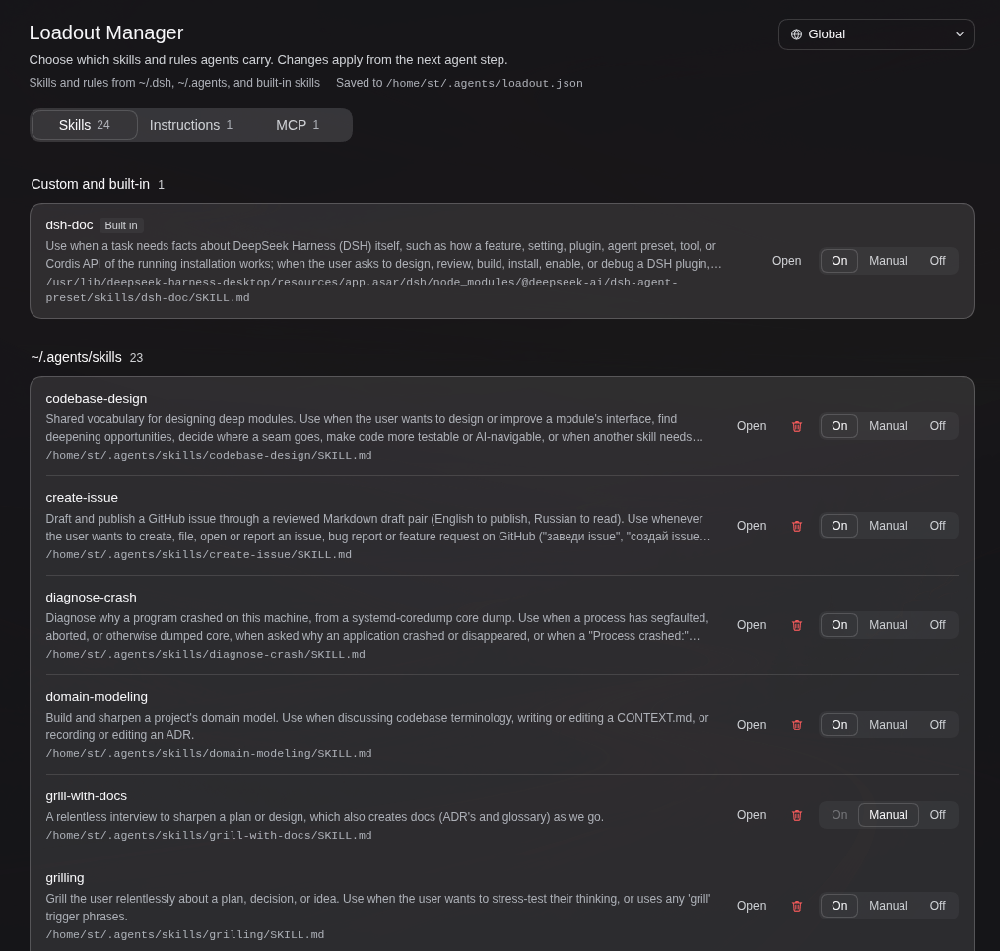

# Loadout Manager

English | [Русский](https://github.com/steindvart/dsh-loadout-manager/blob/main/README_RU.md) | [中文](https://github.com/steindvart/dsh-loadout-manager/blob/main/README_ZH.md)

A plugin for DeepSeek Harness (DSH). Stock DSH has no single page that shows which skills and MCP servers are available globally and in a given project, and it has no rules mechanism. Loadout Manager adds both: it shows skills and MCP servers by level, lets you manage them, adds rules to the agent context next to AGENTS.md, and installs skills and rules from indexes you configure.



## Features

### Overview by level

Loadout Manager appears in the left sidebar. At the top of the page you pick a scope: Global or one of your workspaces. The Skills, Instructions, and MCP tabs show everything the agent gets in that scope, including the AGENTS.md and CLAUDE.md files DSH loads on its own. The Catalog page opens from the header and is covered below. Any file opens right in its row.

### Skill management

| State | Model catalog | `/name` call |
| --- | --- | --- |
| `on` | visible | works |
| `manual` | hidden | works |
| `off` | hidden | hidden |

In `manual` mode the skill's description stays out of the context, but you can still call the skill by hand. When a skill with the same name exists both in the project and globally, the panel marks the overridden one. A skill you no longer need goes to the trash.

### Rules

A rule is a Markdown file in `~/.dsh/rules/`, `~/.agents/rules/`, or `<project>/.agents/rules/`. Enabled rules reach the agent and its subagents right after AGENTS.md, and file edits reach the agent on the next step. Each rule is switched on and off on its own.

### Catalog

The Catalog page installs skills and rules from indexes. An index is a `loadout-index.json` file that lists them. The plugin reads it from three kinds of source, so a team can publish its skills wherever it already keeps files:

| Source | What to enter | How an update is noticed |
| --- | --- | --- |
| Local directory | An absolute path, such as `/srv/shared/skills`, with the index at its root | The digest of the entry's files changes |
| Git repository | `https://github.com/owner/repo`, `owner/repo`, `ssh://…`, or `git@host:path`; the plugin reads the default branch | The entry's git tree or blob id changes |
| HTTP | The URL of the index file, for example in a Nexus raw repository: `https://nexus.example/repository/skills/loadout-index.json` | The entry's `version` changes |

Add a source with the form on the Catalog page, which opens from the Loadout Manager header, or list it in `~/.agents/loadout-indexes.json`:

```json
{
  "format": 1,
  "indexes": [
    "/srv/shared/skills",
    "https://github.com/owner/team-skills",
    "https://nexus.example/repository/skills/loadout-index.json"
  ]
}
```

For Nexus, enter the file URL under `/repository/`. A link copied from the Nexus web UI contains `#`; the plugin refuses it and shows the file URL to use instead.

Any source can serve either index format:

- Format 1 lists paths next to the index: a skill directory with `SKILL.md` or a rule `.md` file. Over HTTP a skill can also be a `.tar.gz` or `.zip` archive.
- Format 2 lists npm packages. Each skill or rule names its versions, the package, and the registry, such as a Nexus npm repository. The plugin installs the version tagged `latest` and checks the tarball against the integrity the registry publishes. The package declares what to install in a `loadout` field of its `package.json`.

A minimal format 1 index:

```json
{
  "format": 1,
  "title": "Team skills",
  "skills": [
    { "name": "tdd", "description": "Test-first workflow", "path": "skills/tdd" }
  ],
  "rules": [
    { "name": "russian-docs", "description": "Russian prose", "path": "rules/russian-docs.md" }
  ]
}
```

On the page you search across all sources, install an entry into the chosen scope, update it when its source publishes newer content or a newer version, and delete an installed copy from the same row. Each row shows which index an installed copy came from. If the name is already taken by a skill you wrote yourself, by a copy from another index, or by a copy with local edits, the row says so and replaces that copy only after you confirm. The replaced copy goes to the trash.

[docs/indexes.md](https://github.com/steindvart/dsh-loadout-manager/blob/main/docs/indexes.md) covers sources, both index formats, and HTTP archives; [docs/catalog.md](https://github.com/steindvart/dsh-loadout-manager/blob/main/docs/catalog.md) covers installs, updates, and replacements.

### MCP management

In Global the switch turns a server on or off in the DSH profile. In a workspace it hides the server's tools from that project's agents while the server keeps running. The Check button makes a trial connection to the server and lists its tools, even when the server is off.

### Managing from the chat

The plugin gives the agent a `loadout` tool, so you can change settings right in the conversation: for example, ask it to "turn off the omarchy skill in this project" or "which rules are on right now?". The agent can show the states of skills, rules, and MCP servers and switch them one at a time. It can also search the catalog with `action: "search"`, but installation stays on the page. Files cannot be deleted from the chat, only on the page.

## Where settings are stored

States are written to `~/.agents/loadout.json` for the global level and to `<project>/.agents/loadout.json` for a project. The source list is `~/.agents/loadout-indexes.json`. Provenance of installed copies is kept in `~/.agents/.loadout-manager/installed.json` and `<project>/.agents/.loadout-manager/installed.json`. States and sources are ordinary files that you can commit and share with your team; the provenance records what this machine installed. The plugin does not edit skill or rule files in place: an index update replaces a managed copy, and `loadout.json` only stores switches.

```json
{
  "skills": { "omarchy": "off", "tdd": "manual" },
  "rules": { "dsh/russian-docs": false },
  "mcp": { "github": false }
}
```

## Installation

The plugin supports DSH 0.2.2-rc.2 and later 0.2.x versions; it is tested on 0.2.2-rc.2. In DSH, open Plugins → Add plugin and enter the npm package name `dsh-loadout-manager`. From the DSH command line:

```sh
dsh plugin --profile <profile> add dsh-loadout-manager
```

The same form also accepts the repository's Git URL or a local checkout. The built `lib/` is committed to the repository, so there is nothing to build after cloning.

The `maxBytes` option in the plugin config limits the size of one rules message: 65536 bytes by default, and `0` turns rules off.

The `autoUpdate` switch (off by default) sits on the plugin's page in **Plugins**, on its configuration row, and takes effect without restarting DSH: while it is on, the plugin refreshes its index sources and updates the installed skills and rules whose source published newer content, once when the switch turns on and then every 30 minutes. Locally edited copies and copies installed from another index are never touched, and only the global level is updated automatically.

## Limitations

- In a session whose agent has not started yet, the `/` menu also lists skills that are off.
- Rules reach only agents whose preset includes `dsh-agent-instructions`. The Minimal preset does not.
- Deletion uses `gio trash`. Where `gio` is missing, including Windows and macOS, the file stays in place and the panel shows an error.
- Built-in skills from `app.asar` can be turned off but not deleted.
- HTTP indexes report updates by `version`; a changed file with the same version looks current. HTTP authentication is not supported, and archives need `tar` or `unzip`.
- npm entries install the version tagged `latest` only, from registries that allow anonymous reads.
- Index entries are third-party content. The plugin validates paths and sizes and asks before replacing a copy that this index did not install or that has local edits; it does not review what a skill or rule tells the agent.

## Development

Requires Node 24 or newer.

```sh
npm install
npm run check   # lint, types, lib/ build, and tests
```

The plugin design is described in [docs/SPEC.md](https://github.com/steindvart/dsh-loadout-manager/blob/main/docs/SPEC.md), and notes on the DSH API are in [docs/research/](https://github.com/steindvart/dsh-loadout-manager/tree/main/docs/research).

## License

MIT, see [LICENSE](https://github.com/steindvart/dsh-loadout-manager/blob/main/LICENSE).
