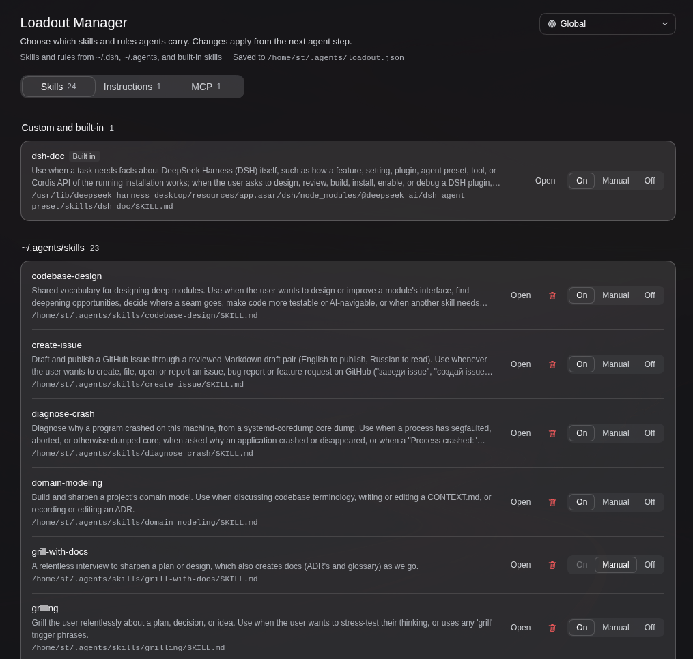

# Loadout Manager

[](https://www.npmjs.com/package/dsh-loadout-manager)

[English](https://github.com/steindvart/dsh-loadout-manager/blob/main/README.md) | Русский | [中文](https://github.com/steindvart/dsh-loadout-manager/blob/main/README_ZH.md)

Плагин для DeepSeek Harness (DSH). В стандартном DSH нельзя на одной странице посмотреть, какие скиллы и MCP-серверы доступны глобально и в конкретном проекте, и нет механизма правил (rules). Loadout Manager добавляет и то и другое: показывает скиллы и MCP-серверы по уровням, позволяет ими управлять, подключает правила в контекст агента рядом с AGENTS.md и устанавливает скиллы и правила из настроенных индексов.



## Возможности

### Обзор по уровням

В левом меню появляется пункт Loadout Manager. Вверху страницы выбирается область: «Глобальные» или один из workspace. На вкладках «Скиллы», «Инструкции» и «MCP» видно всё, что получает агент в этой области, включая AGENTS.md и CLAUDE.md, которые DSH загружает сам. Страница «Каталог» открывается из заголовка и описана ниже. Любой файл открывается прямо в строке.

### Управление скиллами

| Состояние | Каталог модели | Вызов `/имя` |
| --- | --- | --- |
| `on` | виден | работает |
| `manual` | скрыт | работает |
| `off` | скрыт | скрыт |

В режиме `manual` описание скилла не занимает контекст, но скилл можно вызвать вручную. Если скилл с тем же именем лежит и в проекте, и глобально, панель помечает перекрытый вариант. Ненужный скилл удаляется в корзину.

### Правила

Правило – markdown-файл в `~/.dsh/rules/`, `~/.agents/rules/` или `<проект>/.agents/rules/`. Включённые правила попадают в контекст агента и его субагентов сразу после AGENTS.md, а изменения в файлах доходят до агента на следующем шаге. Каждое правило включается и выключается отдельно.

### Каталог

Страница «Каталог» ставит скиллы и правила из индексов. Индекс – это файл `loadout-index.json` со списком скиллов и правил. Плагин читает его из источников трёх видов, так что команда может публиковать скиллы там, где уже хранит свои файлы:

| Источник | Что указать | Как замечается обновление |
| --- | --- | --- |
| Локальная директория | Абсолютный путь, например `/srv/shared/skills`; индекс лежит в её корне | Меняется хеш файлов записи |
| Git-репозиторий | `https://github.com/owner/repo`, `owner/repo`, `ssh://…` или `git@host:path`; плагин читает ветку по умолчанию | Меняется git-идентификатор дерева или файла записи |
| HTTP | Ссылка на файл индекса, например в raw-репозитории Nexus: `https://nexus.example/repository/skills/loadout-index.json` | Меняется `version` записи |

Источник добавляется формой на странице «Каталог», которая открывается из заголовка Loadout Manager, или строкой в `~/.agents/loadout-indexes.json`:

```json
{
  "format": 1,
  "indexes": [
    "/srv/shared/skills",
    "https://github.com/owner/team-skills",
    "https://nexus.example/repository/skills/loadout-index.json"
  ]
}
```

Для Nexus указывайте ссылку на файл под `/repository/`. В ссылке, скопированной из веб-интерфейса Nexus, есть `#`: плагин её не примет и подскажет ссылку на файл.

Любой источник может отдавать индекс в любом из двух форматов:

- Формат 1 перечисляет пути рядом с индексом: папку скилла с `SKILL.md` или файл правила `.md`. По HTTP скилл может быть ещё и архивом `.tar.gz` или `.zip`.
- Формат 2 перечисляет npm-пакеты. У каждого скилла или правила указаны версии, пакет и реестр, например npm-репозиторий в Nexus. Плагин ставит версию с тегом `latest` и сверяет архив пакета с контрольной суммой, которую публикует реестр. Что именно ставить, пакет объявляет в поле `loadout` своего `package.json`.

Минимальный индекс в формате 1:

```json
{
  "format": 1,
  "title": "Team skills",
  "skills": [
    { "name": "tdd", "description": "Test-first workflow", "path": "skills/tdd" }
  ],
  "rules": [
    { "name": "russian-docs", "description": "Russian prose", "path": "rules/russian-docs.md" }
  ]
}
```

На странице можно искать по всем источникам, ставить запись в выбранную область, обновлять её, когда источник публикует новое содержимое или версию, и удалять установленную копию из той же строки. В каждой строке видно, из какого индекса пришла установленная копия. Если имя уже занято вашим собственным скиллом, копией из другого индекса или копией с локальными правками, строка об этом скажет и заменит такую копию только после подтверждения. Заменённая копия уходит в корзину.

Источники, оба формата индекса и архивы для HTTP описаны в [docs/indexes.md](https://github.com/steindvart/dsh-loadout-manager/blob/main/docs/indexes.md), установка, обновление и замена – в [docs/catalog.md](https://github.com/steindvart/dsh-loadout-manager/blob/main/docs/catalog.md).

### Управление MCP

В «Глобальных» переключатель включает и выключает сервер в профиле DSH. В workspace он скрывает инструменты сервера от агентов этого проекта, а сам сервер продолжает работать. Кнопка «Проверить» подключается к серверу на пробу и показывает его инструменты, даже если сервер выключен.

### Управление из чата

Плагин даёт агенту инструмент `loadout`, поэтому настройки можно менять прямо в разговоре: например, попросить «выключи скилл omarchy в этом проекте» или «какие правила сейчас включены?». Агент умеет показывать состояния скиллов, правил и MCP-серверов и переключать их по одному, а ещё искать по каталогу (`action: "search"`). Установка остаётся на странице, удалять файлы через чат тоже нельзя.

## Где хранятся настройки

Состояния записываются в `~/.agents/loadout.json` для глобального уровня и в `<проект>/.agents/loadout.json` для проекта. Список источников лежит в `~/.agents/loadout-indexes.json`, сведения об установленных копиях – в `~/.agents/.loadout-manager/installed.json` и `<проект>/.agents/.loadout-manager/installed.json`. Состояния и источники – обычные файлы, их можно закоммитить и использовать всей командой; сведения об установке относятся к этой машине. Плагин не правит файлы скиллов и правил на месте: обновление из индекса заменяет управляемую копию, а `loadout.json` хранит только переключатели.

```json
{
  "skills": { "omarchy": "off", "tdd": "manual" },
  "rules": { "dsh/russian-docs": false },
  "mcp": { "github": false }
}
```

## Установка

Плагин поддерживает DSH 0.2.2-rc.2 и более поздние версии 0.2.x, проверен на 0.2.2-rc.2. В DSH откройте «Плагины → Добавить плагин» и укажите имя npm-пакета `dsh-loadout-manager`. Из командной строки DSH:

```sh
dsh plugin --profile <профиль> add dsh-loadout-manager
```

Та же форма принимает Git-адрес репозитория или локальный каталог с его копией. Собранный `lib/` лежит в репозитории, поэтому после клонирования ничего собирать не нужно.

Параметр `maxBytes` в конфиге плагина ограничивает размер одного сообщения с правилами: по умолчанию 65536 байт, `0` отключает правила.

Переключатель `autoUpdate` (по умолчанию выключен) находится на странице плагина в разделе **Plugins**, в строке его конфигурации, и действует без перезапуска DSH: пока он включён, плагин перечитывает источники индексов и обновляет установленные скиллы и правила, у которых источник опубликовал более новую версию, – один раз при включении, затем каждые 30 минут. Локально изменённые копии и копии, установленные из другого индекса, не трогаются, а автоматически обновляется только глобальный уровень.

## Ограничения

- Меню `/` в сессии, где агент ещё не запускался, показывает и выключенные скиллы.
- Правила получают только агенты, в пресете которых есть `dsh-agent-instructions`. В пресете Minimal его нет.
- Удаление работает через `gio trash`. Там, где `gio` нет, в том числе на Windows и macOS, файл остаётся на месте, а панель показывает ошибку.
- Встроенные скиллы из `app.asar` можно выключить, но не удалить.
- HTTP-индексы сообщают об обновлении по полю `version`: изменённый файл с той же версией выглядит актуальным. Аутентификация HTTP не поддерживается, для архивов нужны `tar` или `unzip`.
- npm-записи ставятся только в версии с тегом `latest` и только из реестров, которые разрешают анонимное чтение.
- Содержимое индексов – сторонний текст. Плагин проверяет пути и размеры и спрашивает перед заменой копии, которую поставил не этот индекс или в которой есть локальные правки, но не проверяет, чему скилл или правило учит агента.

## Разработка

Нужен Node 24 или новее.

```sh
npm install
npm run check   # линт, типы, сборка lib/ и тесты
```

Устройство плагина описано в [docs/SPEC.md](https://github.com/steindvart/dsh-loadout-manager/blob/main/docs/SPEC.md), заметки об API DSH лежат в [docs/research/](https://github.com/steindvart/dsh-loadout-manager/tree/main/docs/research). Документация написана на английском.

## Лицензия

MIT, см. [LICENSE](https://github.com/steindvart/dsh-loadout-manager/blob/main/LICENSE).
