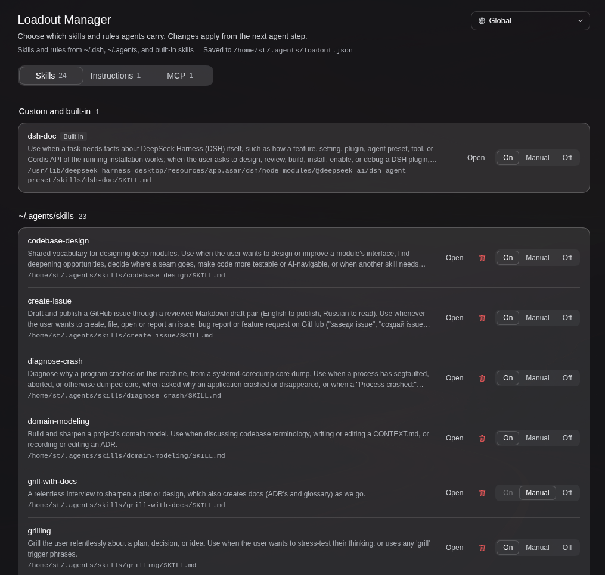

# Loadout Manager

[English](https://github.com/steindvart/dsh-loadout-manager/blob/main/README.md) | [Русский](https://github.com/steindvart/dsh-loadout-manager/blob/main/README_RU.md) | 中文

DeepSeek Harness（DSH）插件。原版 DSH 没有一个页面能同时查看全局和某个项目中可用的技能（skill）与 MCP 服务器，也没有规则（rules）机制。Loadout Manager 补上了这两点：按层级展示技能和 MCP 服务器，提供管理功能，把规则加入智能体上下文，与 AGENTS.md 并列，还可以从配置好的索引安装技能和规则。



插件界面支持中文、英文和俄文，跟随 DSH 的语言设置。

## 功能

### 按层级查看

左侧边栏会出现 Loadout Manager 入口。在页面顶部选择范围：“全局”或某个工作区。“技能”“指令”和“MCP”三个标签页列出智能体在该范围内获得的全部内容，包括 DSH 自动加载的 AGENTS.md 和 CLAUDE.md。目录页面从页头打开。任何文件都可以直接在所在行中展开查看。

### 技能管理

| 状态 | 模型目录 | `/名称` 调用 |
| --- | --- | --- |
| `on` | 可见 | 可用 |
| `manual` | 隐藏 | 可用 |
| `off` | 隐藏 | 隐藏 |

`manual` 模式下，技能描述不占用上下文，但仍可手动调用。如果项目和全局中存在同名技能，面板会标出被覆盖的那一个。不再需要的技能可以移到回收站。

### 规则

规则是位于 `~/.dsh/rules/`、`~/.agents/rules/` 或 `<项目>/.agents/rules/` 中的 Markdown 文件。启用的规则会紧跟在 AGENTS.md 之后进入智能体及其子智能体的上下文，文件修改会在下一步生效。每条规则可以单独启用或停用。

### 目录

索引是一个列出技能和规则的 JSON 文件。把插件指向 Git 仓库、本地目录或 `loadout-index.json` 的 HTTP 链接，然后从 Loadout Manager 页头打开“目录”页面。可以跨来源搜索，把条目安装到选定范围，在来源发布新内容或新版本时更新，也可以在同一行删除已安装副本。面板会显示每个已安装副本的来源，并标记本地修改；更新前会请求确认。

最小索引示例：

```json
{
  "format": 1,
  "title": "Team skills",
  "skills": [
    { "name": "tdd", "description": "Test-first workflow", "path": "skills/tdd" }
  ],
  "rules": [
    { "name": "russian-docs", "description": "Russian prose", "path": "rules/russian-docs.md" }
  ]
}
```

来源列表保存在 `~/.agents/loadout-indexes.json`。来源可以是 Git 仓库（`https://github.com/owner/repo` 或 `owner/repo`）、绝对本地目录，或索引文件的 HTTP 链接。来源、索引格式和 HTTP 归档见 [docs/indexes.md](https://github.com/steindvart/dsh-loadout-manager/blob/main/docs/indexes.md)，安装和更新规则见 [docs/catalog.md](https://github.com/steindvart/dsh-loadout-manager/blob/main/docs/catalog.md)。

### MCP 管理

在“全局”中，开关会在 DSH 配置中启用或停用服务器。在工作区中，开关会对该项目的智能体隐藏服务器的工具，服务器本身继续运行。“检查”按钮会试连服务器并列出其工具，即使服务器已停用也可以。

### 在对话中管理

插件为智能体提供 `loadout` 工具，因此可以直接在对话中修改设置，例如“在这个项目里停用 omarchy 技能”或“现在启用了哪些规则？”。智能体可以查看技能、规则和 MCP 服务器的状态，并逐个切换，也可以用 `action: "search"` 搜索目录。安装仍在页面上进行，对话中不能删除文件。

## 设置保存位置

全局状态写入 `~/.agents/loadout.json`，项目状态写入 `<项目>/.agents/loadout.json`。来源列表保存在 `~/.agents/loadout-indexes.json`，已安装副本的来源记录在 `~/.agents/.loadout-manager/installed.json` 和 `<项目>/.agents/.loadout-manager/installed.json`。状态和来源是普通文件，可以提交到仓库并与团队共享；安装记录属于这台机器。插件不会就地编辑技能和规则文件：索引更新会替换受管理的副本，`loadout.json` 只保存开关。

```json
{
  "skills": { "omarchy": "off", "tdd": "manual" },
  "rules": { "dsh/russian-docs": false },
  "mcp": { "github": false }
}
```

## 安装

插件支持 DSH 0.2.2-rc.2 及之后的 0.2.x 版本，已在 0.2.2-rc.2 上测试。在 DSH 中打开“插件 → 添加插件”，填入 npm 包名 `dsh-loadout-manager`。也可以使用 DSH 命令行：

```sh
dsh plugin --profile <配置名> add dsh-loadout-manager
```

该表单同样接受仓库的 Git 地址或本地克隆目录。构建好的 `lib/` 已包含在仓库中，克隆后无需再构建。

插件配置中的 `maxBytes` 参数限制单条规则消息的大小：默认 65536 字节，设为 `0` 则停用规则。

`autoUpdate` 开关（默认关闭）位于插件设置页面，无需重启 DSH 即可生效：开启后，插件会重新读取索引来源，并更新那些来源已发布更新版本的已安装技能和规则——开启时执行一次，之后每 30 分钟执行一次。本地修改过的副本和从其他索引安装的副本不会被改动，且只有全局层级会自动更新。

## 限制

- 在智能体尚未启动的会话中，`/` 菜单也会列出已停用的技能。
- 只有预设中包含 `dsh-agent-instructions` 的智能体才会收到规则，Minimal 预设不包含它。
- 删除通过 `gio trash` 完成。在没有 `gio` 的系统上（包括 Windows 和 macOS），文件会保留原处，面板显示错误。
- 来自 `app.asar` 的内置技能可以停用，但不能删除。
- HTTP 索引只按 `version` 判断更新：版本号不变而文件变化时不会显示更新。不支持 HTTP 认证，解压归档需要 `tar` 或 `unzip`。
- 索引条目是第三方内容。插件会校验路径和大小，并在替换本地修改过的副本前请求确认，但不会审查技能或规则教给智能体的内容。

## 开发

需要 Node 24 或更高版本。

```sh
npm install
npm run check   # 代码检查、类型检查、构建 lib/ 并运行测试
```

插件设计见 [docs/SPEC.md](https://github.com/steindvart/dsh-loadout-manager/blob/main/docs/SPEC.md)，DSH API 笔记见 [docs/research/](https://github.com/steindvart/dsh-loadout-manager/tree/main/docs/research)。文档为英文。

## 许可证

MIT，见 [LICENSE](https://github.com/steindvart/dsh-loadout-manager/blob/main/LICENSE)。
